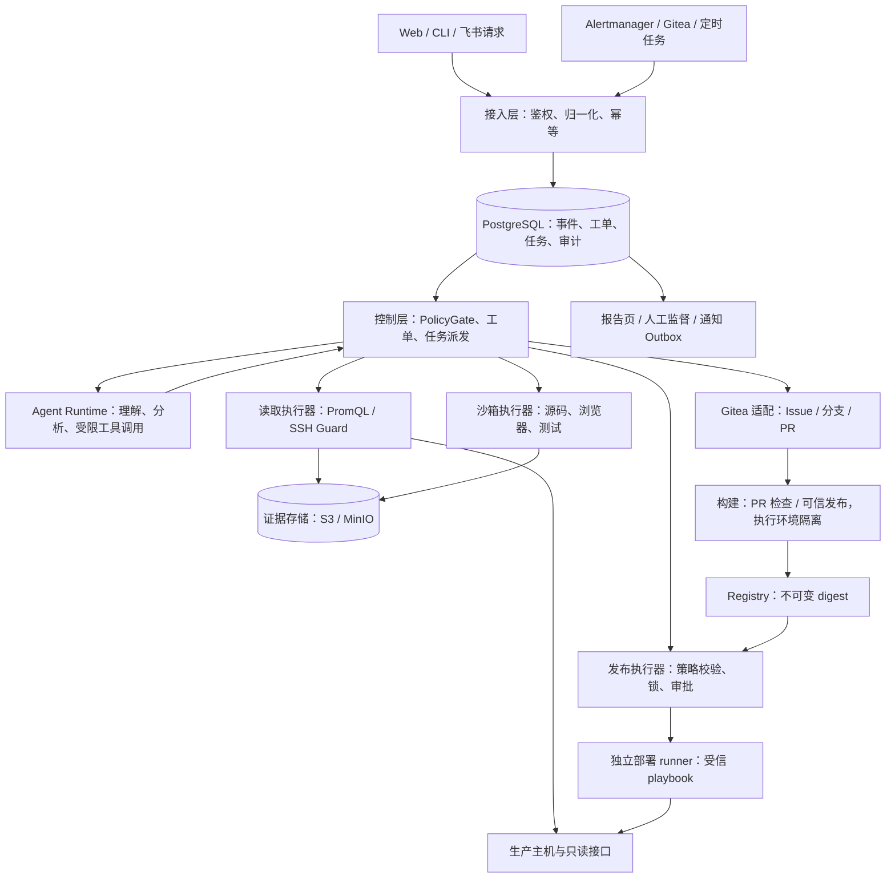
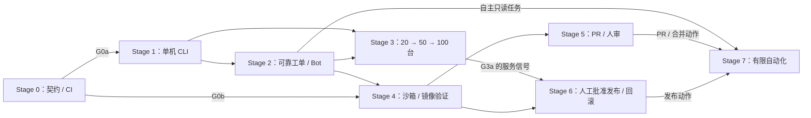

# OPSKAR 架构设计

> 状态：设计草案 v0.5 · 2026-11-03
> 范围：约 100 台异构服务器，无 Kubernetes，逐步收敛到 Docker 部署
> 定位：自研运维控制层，参考 dsh-superagent、rakazo / DS-Bot 的部分设计与实现
> 实现状态：当前仓库只有说明文档；本文中的模块、接口、命令和部署流程均为待建设方案

## 1. 先确定什么

OPSKAR 要把“发现异常 → 收集证据 → 形成判断 → 提出修复 → 验证 → 发布 → 确认恢复”串成可追踪的工作过程。服务器巡检和发布依靠确定性程序执行，LLM 负责理解请求、解释证据和在隔离环境中提出代码修改。

架构中最重要的三个边界：

1. **工单管理授权和进度，Agent Session 管理模型上下文。** Session 结束、模型报错或服务重启，都不能让工单丢失或被误判为完成。
2. **生产读取、沙箱开发、生产发布使用不同的执行器和身份。** Agent 可以在沙箱里运行开发命令和修改源码；生产变更只通过受控发布通道执行。
3. **所有外部动作先登记，再执行，再核对结果。** 开 PR、发通知、部署等动作可能在请求超时后已经成功，不能一律重试。

### 1.1 目标与阶段边界

| 能力 | MVP：Stage 0–4，集群到 G3b | Stage 5–7 |
|---|---|---|
| Web / Webhook / 定时触发 | 支持，入口鉴权，事件持久化 | 扩充接入和规则 |
| 主机、Web、数据库、中间件巡检 | 从少量确定性检查逐步覆盖 | 补齐业务检查包 |
| 浏览器复现 | 沙箱中复现，保存截图、trace 和日志 | 同一套用例进入修复回归 |
| 修复建议 | 有证据的诊断和建议；可在沙箱准备补丁 | 发布 PR、审查和合并 |
| CI | 校验、测试、构建的基础链路 | 对实际合并提交验证，产出可信制品 |
| CD | 不自动修改生产 | 受控灰度、健康判定、全量、回滚 |
| 人工监督 | 工单、证据、问题和失败可见 | 审批与发布记录可见 |

MVP 验收是“能巡检、能追踪、能复现、能出报告”，退出条件为 G0 + G1 + G2 + G3b + G4。Stage 5 交付 PR 与人审修复，Stage 6 交付每次人工批准的发布，Stage 7 再逐项开放自动化。完整门槛见第 13 节。

### 1.2 CI/CD 在本阶段的决定

**现在确定主路线、职责和接口，分阶段建设完整流程。**

推荐路线：

```text
Gitea → Gitea Actions / act_runner → Gitea Packages
      → 发布执行器 → Ansible + Docker Compose
```

现在固定：提交 SHA 与制品 digest 的对应关系、检查结果契约、构建和部署权限分离、发布串行化、回滚目标、审批绑定对象。

Stage 0 验证实际 SHA、检查状态和基础 runner 隔离；Stage 4 验证镜像推拉与来源证明；Stage 5 验证 PR / 评审事件；自动合并条件在 Stage 7 开放前验证。具体产品版本、缓存、镜像签名工具和灰度参数随验证记录到 ADR。Harbor 在需要更强的制品管理能力时再引入。

### 1.3 本期不做

- Kubernetes、多租户、计费、对外 SaaS。
- CMDB 界面、告警平台、采集探针的重复建设。
- 完整复制 dsh-superagent 的插件平台、群聊路由和多工单扇出机制。
- LLM 自行选择生产命令、修改生产文件或取得部署凭据。
- 未经过恢复演练的自动部署、自动数据库恢复。

资产以 Git 中的 YAML 为事实源，指标与告警使用 Prometheus / Alertmanager，执行优先使用已有工具。

## 2. 参考项目与取材边界

### 2.1 已核对的 dsh-superagent-prototype

本地参考目录：`../dsh-superagent-prototype`。

本次核对版本：`6337fc823ce20251c8de8085948165c81aaa701e`。其 README 明确定位为研究原型，不能仅根据设计完整或存在测试就视为生产可用。

它提供的关键经验：

| 设计 | 原型对应位置 | 在 OPSKAR 中的用途 |
|---|---|---|
| Source → Trigger → Eval → Ticket → Assignment | `docs/001-domain.md`、`src/core/` | 事件、授权工作与执行尝试分离 |
| Policy / Mandate，上下文不增加权限 | `docs/002-authorization.md`、`src/policy.ts` | 将授权依据和操作范围记录到工单 |
| 独立 Executor 接口 | `src/core/ports.ts` | 对接巡检、沙箱和发布执行器 |
| 事务后执行 Effects / Outbox | `src/app/effects.ts`、`src/app/outbox.ts` | 重启恢复、通知重试和动作核对 |
| 等待人工、失败和就绪的结构化状态 | `src/core/stage.ts`、`docs/003-execution.md` | 工单状态不依赖模型自由文本 |
| 优先展示需要处理的事项 | `docs/005-panel.md` | 运维页面先显示异常、审批和失败 |

需要明确区别：

- 原型的 `src/core` 基本只依赖自身模块和 Node 哈希能力，适合作为领域设计参考；完整复制仍会带入大量路由和订阅语义。
- `src/executor/dsh.ts`、Session 投递、面板集成深度依赖 DeepSeek Harness。**它不是可直接搬入 Hono 服务的 Agent 内核。**
- 原型主要面向一个 github.com 仓库，使用 `gh`；不能通过改 API 地址就得到 Gitea 适配。
- 默认执行权限是宿主 OS 用户的 `danger-full-access`，账号包装器不提供进程隔离；OPSKAR 必须另建执行边界。
- 原型没有生产服务器巡检、制品发布、灰度和回滚实现。
- 原型使用 SQLite，且文档指出部分记录尚无清理机制。OPSKAR 使用 PostgreSQL，并从开始定义保留策略。
- 原型对运行中工单的策略变更以通知为主。OPSKAR 的生产写操作必须在执行时重新校验当前策略。

### 2.2 三类来源的职责

| 来源 | 主要参考内容 | 当前决定 |
|---|---|---|
| dsh-superagent | 工作授权、工单生命周期、执行器端口、持久化副作用、监督页面 | 控制层的主要设计参考，按运维场景重写 |
| rakazo | 会话工具循环、压缩策略、定时触发、沙箱和审批设计 | 逐模块核对后决定取材，不作为运行依赖 |
| DS-Bot | 多角色协作与权限设计 | Stage 8 再评估，不提前实现 |

rakazo / DS-Bot 的具体检出版本、许可证和可抽取模块尚未在本次核对中确认，不把旧草案中的判断当成已验证事实。dsh-superagent-prototype 的 LICENSE 为 **MIT**，不能套用其他参考项目的 Apache 2.0 声明。

### 2.3 取材规则

| 类别 | 条件 | 做法 |
|---|---|---|
| A：抽取实现 | 职责窄、运行时依赖清楚、无隐藏权限和 I/O、能独立验证 | 复制必要实现和相关测试，删掉不用的分支，保留许可与来源 |
| B：参考后重写 | 核心思路可用，但领域或存储、框架、身份耦合明显 | 在本项目契约下实现；工单主流程和 Executor 属于这一类 |
| C：暂不引入 | 不能服务当前验收目标 | 暂缓插件平台、多渠道身份映射、复杂接力和移动端 |

内部 import 数量只是阅读线索，不能代替对状态所有权、运行权限和副作用的判断。

每块实际引入的代码登记到 `docs/provenance.md`：项目、完整 commit、原路径、许可证、修改说明、关联测试、后续关注的上游路径。未复制代码时，记录为设计参考，不声明已经完成移植。

## 3. 总体架构



### 3.1 分层职责

| 层 | 职责 | 是否使用 LLM |
|---|---|---|
| 接入层 | 验证身份和来源、限流、记录事件、处理重复投递 | 否 |
| 控制层 | 授权、状态转换、任务派发、预算、取消、审计 | 否 |
| Agent Runtime | 理解请求、解释证据、提出后续动作、沙箱开发 | 是 |
| 执行器 | 参数验证、执行、超时、结果归一化、核对外部状态 | 否 |
| 数据层 | 结构化结果、证据、指标、制品和历史 | 否 |
| 通知与监督 | 回原会话、展示人工问题、审批和异常 | 文案可由 LLM 生成，发送条件由代码决定 |

“Agent Runtime”与“控制层”不是同一套循环。模型可以更换，工单和执行任务保持原状。

### 3.2 稳定边界

领域层不访问网络、文件系统、SSH、Docker 或模型服务。应用层通过事务保存领域变化与待执行任务，执行器实现实际 I/O。

```ts
type ActionKind =
  | 'inspect'
  | 'collect_evidence'
  | 'sandbox_run'
  | 'publish_issue'
  | 'publish_pr'
  | 'merge_pr'
  | 'deploy'
  | 'rollback';

interface ExecutorPort {
  execute(job: AuthorizedJob, signal: AbortSignal): Promise<ActionResult>;
  reconcile(job: AuthorizedJob): Promise<
    | { state: 'succeeded'; result: ActionResult }
    | { state: 'failed' | 'cancelled'; result: ActionResult }
    | { state: 'not_started' }
    | { state: 'running' }
    | { state: 'unknown'; reason: string }
  >;
}
```

以上为接口方向，`AuthorizedJob` 和 `ActionResult` 应在共享契约中定义。类型名本身不提供安全保障：授权任务必须由服务端签发，执行器验证任务记录、范围、有效期和当前策略。

`failed` / `cancelled` 表示已确认远端动作结束。`ActionResult` 同时记录 `side_effects: none | partial | complete | unknown`、已完成步骤、错误码和证据引用；本地超时或触发 AbortSignal 不足以证明远端已停止。动作结果与重试决定分开：执行器报告事实，控制层按第 5.3 节决定重试、补偿或转人工。

### 3.3 模型回合与长任务

模型提出工具调用后，控制层校验参数和 Mandate，再登记 Job。巡检、沙箱测试和发布等长任务返回 job ID；模型回合结束，工单进入等待任务状态。完成事件保存后再推动后续回合，不靠循环查询或 sleep 占用模型并发。

- 工具调用、动作计划和结果分别持久化；同一步骤的重复提交复用稳定动作 ID。模型重试不能再次创建同一个外部写动作。
- 模型槽位与执行器槽位独立：初始模型并发 2、沙箱并发 2、SSH 全局并发 20，发布按服务/环境串行。等待任务或人工输入时释放模型槽位。
- 模型回合预算计算实际模型/工具编排时间；长任务另有截止时间，工单另有累计预算与授权有效期，等待不能无限延长授权。
- Session / Step 保存消息、工具调用和结果引用以供恢复，属于运行数据。工单完成条件和授权不从 Session 历史推断。

上下文压缩只压缩讨论和证据摘要。当前授权、策略、目标版本、工具定义和待处理任务从权威状态重新生成，不能依赖模型记忆；原始日志、网页和消息始终作为输入数据呈现。

## 4. 事件、授权与工单

### 4.1 最小领域模型

| 概念 | 定义 | 必须保持的规则 |
|---|---|---|
| Source | 一个配置好的事件来源 | 身份、读取位置和接收范围由适配器维护 |
| Trigger | 一次不可变输入事件 | 外部事件 ID 唯一；正文不能覆盖来源身份 |
| AlertOccurrence | 同一来源的一轮告警发生，Stage 3 引入 | 以来源、fingerprint、startsAt 标识；与投递事件和工单分别记录 |
| Thread | 外部请求或事件的讨论上下文 | Gitea Issue / PR、飞书话题分别使用稳定 ID |
| Decision | 接受、忽略、拒绝或评估失败的记录 | 记录策略版本和理由 |
| Mandate | 一项工作的授权快照 | 明确对象、环境、动作、依据和有效期 |
| Ticket | 一项已授权工作 | 不跟随模型 Session 的结束状态 |
| Assignment | 某个执行器对工单的一次执行尝试 | 重试创建新尝试，保留旧记录 |
| Job | 一次确定性动作 | 有幂等键、截止时间、结果和执行记录 |
| Approval | 对具体写操作的人工批准 | 绑定计划摘要，修改计划后失效 |
| Outbox | 待发送的外部通知 | 与工单变化同事务登记，异步投递 |

MVP 保留一个主要请求对应一个工单。后续消息只有在指向该工单、PR 或来源消息时才绑定；相关讨论作为上下文，不按话题相似度自动增加工作范围。复杂的多工单扇出和 handback 暂缓。

### 4.2 授权快照

Mandate 至少包含：

```text
id, ticket_id, origin_trigger_id, requester/source_identity,
basis(explicit_request | routine | policy_rule),
policy_version, matched_rule_ids,
scope(environment, host_ids, service_ids, service_instance_ids, repository_ids, allowed_actions),
created_at, expires_at, withdrawn_at
```

- 主机选择器在接单时展开为明确的主机 ID，并保存 inventory commit；新加入的机器不会自动进入旧工单。
- 服务与实例检查同时固定已授权的服务、实例及其主机映射；模型不能通过选择服务聚合检查，把未获授权的实例或主机带入计划。
- 一次请求“巡检 web-01”默认只授予读取和报告权限。
- 定时巡检和指定告警的只读任务使用管理员预先批准的 Routine / 触发模板；对象、动作和预算固定，不依赖模型推断是否接单。
- 告警可以根据已启用规则触发取证；修复、开 PR、合并和部署需要分别获得相应动作范围。
- 扩大环境、仓库、主机、服务、服务实例或动作范围必须形成新的授权记录，不能由模型自行改写原 Mandate。
- 恢复旧工单、领取新任务和执行写操作时重新校验权限；正文、日志、网页、引用内容都不是授权来源。

### 4.3 主动任务模式

| 模式 | 对未直接请求的候选任务 |
|---|---|
| `off` | 只记录事件，不主动接单 |
| `observe`，默认 | 评估并记录“本会接单”，不实际执行候选任务 |
| `auto` | 仅按启用的书面规则接受，并限定动作范围 |

明确的人类请求和预先授权的 Routine / 固定告警读取模板按各自授权执行。这些任务可以在 Stage 2–3 运行；模板之外的新自主候选才依赖主动任务模式，Stage 7 逐项放开。上述模式不等于生产写权限；即使开启 `auto`，发布执行器仍执行自己的门禁。

机器人和 CI 消息不能伪装成人类授权。它们可以补充既有工单的证据，或依照规则形成主动候选。Bot 自己的提交、评论和状态回调不能不断创建新工单。

### 4.4 工单和执行状态

Ticket 的生命周期与 Assignment / Job 分离：

```text
Ticket:     open → closed；通过显式恢复命令且重新鉴权后可 closed → open
Outcome:    completed | failed | cancelled | dropped
Assignment: pending → running → ended
Job:        queued → running → succeeded
                    ├→ retry_wait → running
                    ├→ unknown → reconcile / 人工处理
                    ├→ failed
                    └→ cancelled
```

需要继续已结束工作时，通过重新鉴权的命令建立新 Assignment；只允许恢复同一授权范围，取消且已撤回授权的工作不能被自动恢复。

Assignment 的结构化 Report 可为 progress、waiting、ready、blocked 或 failed。blocked / failed 报告可以让工单保持 open 等待人工；只有控制层确认终止或满足完成条件才关闭工单。已撤回授权的取消工单收到新请求时重新接单，不能直接重新打开。

页面状态从结构化事实计算，优先展示：结果未知、待审批、待回答、受阻/失败、待审查、工作中、等待外部事件、结束。不要从“我已经完成了”这样的模型文本推断完成状态。

- 巡检完成：预期检查均有结果，包括明确记录的 unknown / error，并且报告已生成。
- 复现完成：保存可复核的步骤、目标源码版本和失败证据。
- PR 已创建：表示可审查，不表示修复已验证或工单已完成。
- 发布完成：批准的发布策略全部步骤及观察窗口通过，并记录各目标实例实际运行的 digest、配置和接流状态。
- 通知发送状态单独记录，不把发送失败改写成业务动作失败。

### 4.5 停止、暂停与策略变更

- 停止工单撤回后续授权，取消尚未开始的任务。运行中的读取和沙箱任务尽快停止并保存结果。
- 正在发布的任务进入安全停止点；依据已授权的补偿策略恢复上一版本。不能在半次发布中直接杀掉全部执行。
- 暂停处理后，来源继续登记事件；不启动新模型回合、任务或发布。
- 权限或策略收紧后，尚未执行的写操作立即重新判定。运行中的写流程在下一步校验，保留已发生动作和补偿记录。
- 紧急回滚使用该次发布预先授权的补偿范围，不能借回滚扩大目标或恢复数据库。

## 5. 持久化任务与恢复

### 5.1 单库事务，不引入独立消息队列

MVP 使用 PostgreSQL 同时存储控制状态和任务队列。工单变化、审计事件、Job / Outbox 登记在一个事务内完成；外部请求不放在数据库事务中。

Worker 使用 `FOR UPDATE SKIP LOCKED` 领取到期任务，并写入租约、执行尝试和领取版本。执行结束通过版本比较更新结果，旧 worker 的迟到结果只能登记为旧尝试，不能覆盖当前状态。

关键约束：

```text
UNIQUE(source_id, external_event_id)
UNIQUE(ticket_id, action_kind, idempotency_key)
UNIQUE(routine_id, scheduled_for)
UNIQUE(message_id)
```

工作量达到 PostgreSQL 队列瓶颈后再考虑额外队列，不能同时把数据库与消息队列都当工单状态事实源。

### 5.2 默认预算与重试

| 动作 | 初始预算 | 失败处理 |
|---|---|---|
| Prometheus 查询 | 单次 10 秒，有限并发 | 短暂网络错误最多重试 2 次，随后返回 unknown |
| SSH 取证 | 单机连接 5 秒、动作 30 秒，全局并发不超过 20 | 超时留结果；不让一台机器阻塞全量 |
| 全量巡检 | 50 台目标不超过 5 分钟 | 超预算结束并标记未完成项 |
| 模型回合 | 5 分钟，工具调用和 token 有上限 | 短暂服务错误最多重试 2 次；超限进入受阻 |
| 沙箱任务 | 默认 20 分钟，限 CPU / 内存 / 磁盘 | 超时停止，先保留证据再清理 |
| 外部写动作 | 按动作单独设截止时间 | 先 reconcile，再决定是否重试 |
| 通知 | 指数退避，最大间隔 5 分钟 | 连续失败 3 次显示问题；超投递时限后进入人工处理 |

这些是起始默认值，实测后按检查项和服务调整。重试不能重置工单总预算，禁止无限“继续尝试”。

租约初始配置为心跳 10 秒、失联 30 秒。租约到期只说明控制层失去联系，不证明远端动作已停止；写任务转入 `unknown` 并核对远端状态。

### 5.3 幂等与结果未知

外部系统不保证 exactly-once。OPSKAR 提供“至少一次投递 + 稳定动作 ID + 动作端幂等或结果核对”。

- 建分支、开 PR、发 Issue：使用稳定分支名和机器可读动作标记，重试前查询已有对象。
- 更新、合并：绑定预期提交，读取当前状态；不能把不同提交当同一次操作。
- 部署：绑定 deployment ID、service、environment、digest 和配置摘要，核对目标机实际状态。
- 通知：渠道支持幂等键就传入；不支持时，崩溃窗口可能产生重复消息，必须记录这一限制。
- 数据库状态提交失败但远端动作可能成功时，保留任务为 `unknown`，不伪造成功或直接再执行。

每个写执行器都必须实现 `reconcile`。尚未实现结果核对的动作不能开放自动执行。

- 核对确认成功、失败或取消后，保存对应尝试的终态与已发生副作用；不把已确认失败长期留在 `unknown`。
- `not_started` 必须有可靠依据；仅查不到结果不等于未执行，还须确认旧尝试不会随后开始。`running` 继续等待，`unknown` 保持核对或转人工，不直接重发写动作。
- 只有确认无副作用或动作具备已验证的幂等重试能力，且当前授权、截止时间和预算仍有效时，才登记下一次尝试。失败或取消时存在部分/未知副作用，先核对已完成步骤，并按已授权范围补偿或交人工；不能通过把状态改回 queued 清除执行历史。

### 5.4 定时任务与事件风暴

Routine 保存触发类型和授权模板。定时类型另保存时区、cron、下次触发时间和漏跑策略；告警类型保存已批准的来源与匹配范围。界面按 `Asia/Shanghai` 展示，持久化时间统一 UTC。

- 调度器事务性登记 `routine_id + scheduled_for`，多个 worker 不会重复生成同一任务。
- 默认同一 Routine 不重叠；重启后只补最近一次到期任务，更早漏跑记录为跳过。
- 环境、服务/主机、规则和 fingerprint 用于关联同类告警上下文；一轮发生以 `source_id + fingerprint + starts_at` 唯一标识为 AlertOccurrence。`starts_at` 来自源事件 `startsAt`，状态及预计结束时间不参与本轮身份。
- Trigger 保留不可变投递事实，AlertOccurrence 保存本轮状态及关联工单。重复 firing 只更新本轮观测；并发处理时，每轮最多建立一个主要工单。相同 fingerprint 的新 startsAt 表示新一轮，按当前 Routine / PolicyGate 重新判定是否接单，只关联历史工单，不自动重开旧工单或继承旧 Mandate。
- resolved 只更新对应轮次及工单证据；旧轮次的迟到 resolved 不影响新轮次。若先收到 resolved，再收到同轮 firing，保存乱序记录，不自动退回 firing 或启动新工作；与来源当前状态冲突时核对来源，不能仅按接收时间覆盖状态。
- 告警恢复与工单完成分别判定，不能仅凭一条 resolved 就认定修复成功。
- 各来源有限流和积压告警；风暴时保持事件记录，合并评估和通知，优先已有生产故障。

## 6. 巡检架构与数据契约

### 6.1 两条读取路径

**指标走 Prometheus，证据走 SSH Guard。**

```text
CLI / Routine / Web 请求
  → 校验 inventory 和检查集
  → 固定检查计划与版本
  → 按不同 PromQL 模板批量查询所有目标
  → 与预期目标逐项对齐，识别缺失/过期数据
  → 异常机器按规则进入 SSH 取证队列
  → 保存结果与证据
  → 确定性阈值/趋势判定
  → 模型解释与报告
```

Prometheus instant query 一次 HTTP 执行一个表达式，不假设一次请求可查询所有不同检查项。按表达式聚合目标，限制并发，并记录查询时间和样本新鲜度。

SSH 不是模型生成命令的通道。它只调用被管机上预置的 `ops-guard`，以检查 ID 和有限参数选择固定实现，输出结构化 JSON。

### 6.2 CLI 必须独立运行

规划命令：

```bash
pnpm ops inspect --host web-01 --format markdown
pnpm ops inspect --role web --format json
pnpm ops validate
```

CLI 与 worker 复用相同的检查计划、采集器和规则计算。CLI 不依赖 API、Web、模型服务或控制数据库：本地读取配置，输出 report.json / Markdown 和本地证据；接入控制层时将相同结果导入 PostgreSQL / S3。

模型不可用时，仍能完成检查和确定性报告。CLI 的执行身份和网络权限仍受同样约束。

### 6.3 资产事实源

`inventory/hosts.yaml`：

```yaml
schema_version: 1
hosts:
  web-01:
    address: 10.0.1.11
    environment: prod
    roles: [os, web]
    ssh: {port: 22, user: opsbot-ro}
    check_sets: [os.base]
    owner: team-shop
```

`inventory/services.yaml`：

```yaml
schema_version: 1
services:
  shop-web:
    environment: prod
    instances:
      shop-web-01: {host_id: web-01}
    check_sets: [web.http]
    repository: team/shop-web
    base_branch: main
    health: {scheme: http, port: 8080, path: /healthz}
    deploy_recipe: docker-compose-v1
    owner: team-shop
```

以上地址和服务为示例。inventory 是唯一事实源；数据库保存可查询投影和每次执行的配置快照。主机组、Ansible inventory、Prometheus file_sd 从它生成，不维护第二份手工清单。

服务实例 ID 在环境内唯一，表示受管理的逻辑实例，不使用容器重建后变化的 container ID。服务的主机目标从 `instances` 展开；同机多个服务或实例分别登记，健康端口等实例差异通过经 schema 校验的实例配置覆盖服务默认值。Stage 1 可以只登记主机，首次纳管服务时再增加相应实例。

地址、端口、主机 ID、仓库和服务关系必须通过 schema 和允许网段校验。停机维护有明确起止时间与原因，不能通过删掉 target 让报告变绿。

### 6.4 检查定义

检查定义是受版本控制的配置，不实现脚本语言或动态表达式执行器：

```yaml
schema_version: 1
id: disk.root
version: 1
title: 根分区使用率
applies_to: [os]
source:
  kind: prometheus
  query_template: filesystem.root.used_percent
timeout_seconds: 10
unit: percent
thresholds:
  - {gte: 90, severity: crit}
  - {gte: 80, severity: warn}
evidence:
  operation: disk.root
  collect_on: [warn, crit]
cooldown_seconds: 1800
```

- PromQL 模板和 SSH operation 在执行器代码/受信配置中登记。模型只能选择已登记 ID。
- SSH 检查使用 `source.kind: ssh` 和已登记 operation；不能在请求中传入任意 `run` 字符串。
- 阈值只有一个事实源，按严重程度从高到低匹配；不再同时维护冲突的 `assert` 与 `severity`。
- 不适用的检查记录 skipped 和原因。采集失败记录 error，样本缺失或过期记录 unknown，不能转成数值 0。
- cooldown 只抑制重复通知，不停止采集，也不隐藏严重程度升级或恢复事件。

检查计划将定义展开成检查实例，最小契约为：

```text
check_instance_id, environment,
target_ref(kind: host | service | service_instance, id),
check_id, check_version, parameters, inventory_commit
```

`check_id` 标识可复用的检查定义；`check_instance_id` 根据环境、目标引用、check_id 与经校验的规范化参数生成稳定标识。参数可区分同机不同挂载点、端口或数据库实例；相同输入重复规划得到相同标识，不以时间、随机数或临时容器 ID 区分。检查版本和 inventory commit 随计划固定，重试不得改写原计划；目标或参数变化时建立新计划。

按主机巡检展开主机自身及范围内已授权服务实例的检查；服务级聚合检查只有在全部必要目标均获授权时才纳入计划。执行地址、实例所属服务与主机从固定的 inventory 快照解析，不能使用模型传入的任意地址。结果、findings、取证 Job 和证据引用均关联同一个检查实例。

### 6.5 巡检结果

```json
{
  "schema_version": 1,
  "run_id": "run-example-001",
  "ticket_id": null,
  "trigger": "cli",
  "inventory_commit": "example-inventory-commit",
  "check_bundle_hash": "sha256:example-check-bundle",
  "started_at": "2026-11-02T00:00:00Z",
  "finished_at": "2026-11-02T00:01:00Z",
  "execution_status": "completed",
  "summary": {
    "hosts_total": 1,
    "hosts_ok": 0,
    "checks_expected": 3,
    "checks_observed": 2,
    "checks_unknown": 1,
    "checks_error": 0,
    "checks_skipped": 0,
    "coverage": 0.6667
  },
  "results": [
    {"check_instance_id": "ci-example-load", "target_ref": {"kind": "host", "id": "web-01"}, "check_id": "os.load", "status": "ok", "value": 0.4, "unit": "ratio"},
    {"check_instance_id": "ci-example-disk", "target_ref": {"kind": "host", "id": "web-01"}, "check_id": "disk.root", "status": "warn", "value": 84.2, "unit": "percent"},
    {"check_instance_id": "ci-example-shop-health", "target_ref": {"kind": "service_instance", "id": "shop-web-01"}, "check_id": "web.health", "status": "unknown", "value": null, "reason": "sample_missing"}
  ]
}
```

该例表示执行结束，但检查覆盖不完整；其中检查实例 ID 为示意值。每个计划中的检查实例必须对应一个结果，唯一键为 `run_id + check_instance_id`，结果状态为 `ok | warn | crit | unknown | error | skipped`。同机两个服务的 `web.health` 或两个挂载点的同类检查分别计数，不能互相覆盖。

完整结果还应包含环境、检查版本、规范化参数、解析后的主机/服务关联、采集与查询时间、阈值命中、错误码和 evidence ID。coverage 分子只计有效观测；分母是计划中应执行的检查实例数，预先批准的不适用项单独记录，不把临时采集失败排除。只有主机自身及本次计划中归属该主机的服务实例检查全部为 ok，且至少有一项应执行检查时，才能计入 hosts_ok；服务级聚合结果单独展示，不重复计入各主机检查数。

报告分开显示执行是否完成、健康情况和数据覆盖率。严重异常与采集故障都进入 findings，保留各自类型。

### 6.6 阈值与趋势

- MVP 使用确定性硬阈值；关键项包括磁盘、证书、端口、复制状态、备份新鲜度。
- 自身 7 日趋势由 Prometheus 范围查询或连续观测计算，必须有足够时间覆盖；样本不足显示不可判定。
- 保留正常观测或日聚合，不能只存异常 findings 却依赖它计算趋势。
- 同角色横向偏离延后到 Stage 8，在同服务、环境和资源条件的群组中离线验证误报率后启用。
- LLM 解释规则结果与证据，不负责计算权威阈值或决定采样缺失是否健康。

## 7. 沙箱与代码修复

### 7.1 沙箱职责

每个开发 Assignment 有独立 workspace，以 ticket / assignment ID 标识，保存 base SHA 和测试配方。工作目录不是权限边界，必须放在隔离执行环境里。

允许：克隆指定仓库、安装依赖、修改源码、运行开发命令、启动测试服务、使用 Playwright、生成补丁和证据。

约束：无生产凭据、无生产网段访问、无宿主 Docker socket；限制资源、端口、寿命和出站目的地。沙箱里的源码、依赖脚本和网页均按不可信内容处理。

控制层通过受控通道准备源码；发布分支、提交和 PR 由 Gitea 适配器完成。Agent 不取得可推送或合并的 Gitea token。

### 7.2 两级验证

| 环境 | 验证 | 制品 |
|---|---|---|
| 沙箱内环 | 进程方式启动源码，运行复现/回归用例 | 步骤、日志、截图、trace、补丁 |
| CI 外环 | 构建实际镜像，Compose 启动测试栈，运行相同关键用例 | 检查记录、测试证据、镜像 digest |

沙箱是否支持 rootless 构建在 Stage 4 实测，不作为 MVP 必须条件。镜像级验证由隔离构建 runner 承担，不为方便构建而给沙箱特权。

真实外部依赖在测试环境提供；不能为了复现直接连接生产数据库或使用生产写账号。

### 7.3 修复验收

1. 固定目标版本，保存修复前失败证据；测试不能复现时标记未确认。
2. 在沙箱准备补丁，验证修复后通过，并检查相关回归。
3. 给出修改范围、假设、验证结果和剩余问题。
4. 经授权发布 PR，CI 对指定版本重新验证。
5. 符合合并策略后进入第 8 节的变更通道。

模型自审可以补充意见，不能代替 CI、策略门禁或人工审批。检查轮数和总预算有限，重复失败进入人工处理。

## 8. CI/CD 技术路线与变更通道

### 8.1 当前推荐，何时建设

| 环节 | 当前推荐 | 建设阶段 | 保持稳定的契约 |
|---|---|---|---|
| 代码与评审 | Gitea，保护默认分支 | Stage 0 接入源码/CI；Stage 5 评审；Stage 7 合并队列 | repository、base/head SHA、PR ID |
| CI | Gitea Actions + act_runner | Stage 0 最小检查；Stage 4 镜像验证 | 每项检查绑定实际提交，返回结构化状态 |
| 镜像 | Gitea Packages | Stage 4 | commit SHA → image digest + 验证记录 |
| 发布 | 独立 runner + 受信 Ansible / Compose 配方 | Stage 6 | deployment ID、目标、配置摘要、digest |
| 灰度与回滚 | 发布执行器维护状态，Prometheus / HTTP 检查判定 | Stage 6 | 上一已验证版本与逐步执行记录 |
| Harbor | 按制品管理需要评估 | Stage 8 可选 | 不改变按 digest 部署的接口 |

Stage 0 统一 `pnpm check` 并接入真实最小 CI。契约与本地检查通过后，Stage 1 可以并行开发；CI 尚未接通时 G0b 仍未通过，MVP 不能验收。镜像 CI 在 Stage 4 扩展，人工批准的 CD 在 Stage 6 建设，自动化在 Stage 7 按动作开放。

首次生产发布前，基础 CI、制品可追溯、审批绑定、隔离 runner 和测试环境回滚演练必须全部通过；自动发布还须通过 G6b 与对应 G7。

### 8.2 构建和部署分离

**构建 runner 执行仓库代码，部署 runner 执行受信发布代码。**

- 构建 runner 没有生产 SSH 凭据和生产网段访问。来自 PR 的代码、Dockerfile、测试和依赖安装只能在这里运行。
- 构建 runner 的 Docker 权限属于其隔离宿主，不能挂载管理节点或生产主机的 socket。
- PR / 候选补丁构建与可信分支发布构建属于不同信任范围，不能共享可写 workspace、Docker daemon 或可被 PR 修改的缓存。可复用的公共缓存以只读方式提供，并验证内容摘要；可信构建从已验证的干净环境开始。
- 能控制构建宿主 Docker 的 PR job 使用任务结束后可销毁的 VM 或等效隔离宿主；只清理工作目录、重建 job 容器不能证明宿主已恢复可信。可信发布池不直接复用执行过此类 PR job 的宿主；重新纳入前须重建整个受影响执行环境。具体隔离方式在 Stage 4 实测后记入 ADR。
- 发布制品的凭据只在可信分支的受限发布步骤可用；不对任意 PR job 注入。
- 部署 runner 不执行 PR 中的脚本，配方来自受保护的运维仓库，发布时固定配方 commit。
- 生产凭据在策略验证后按本次环境和目标短期授予第 8.5 节确定的受信部署执行入口，runner 不得另持绕过该入口的生产写通道。
- runner 标签只是路由，不是权限控制。必须验证 Gitea/runner 是否真正限制仓库、工作流和凭据的使用；未满足时，部署改由独立受控服务触发。

### 8.3 合并前门禁

生产写策略由代码执行，不能依靠 PR 标签、模型承诺或代码行数单独分类。

| 变更 | 初始自动策略 |
|---|---|
| 已授权服务、允许路径中的小范围 bugfix | Stage 7 对应动作验收后按白名单开放；CI 和回归通过 |
| 非敏感配置值 | 仅命中明确字段白名单时开放 |
| 依赖升级、新增依赖、安装脚本变化 | 初始全部人审，后续再评估 patch 自动化 |
| CI、部署配方、权限、密钥、DB 迁移、安全相关路径 | 人审；生产高风险动作要求两位有权限的审核者 |
| 二进制、symlink、submodule、大范围或无法分类的 diff | 人审 |

初始自动合并范围限定为一个服务、最多 200 行非生成代码变更。范围阈值是附加上限，不等于授权；最终规则按仓库登记和版本化。

合并检查绑定：当前 head SHA、base SHA、diff 摘要、策略版本、必要检查和审批。head/base 变化使检查与审批失效。

必须验证所选 Gitea 版本能否在合并时原子校验预期 head 与必要检查。若无法保证提交条件，不启用自动合并；两次读取状态不能替代原子合并条件。

自动合并仓库还必须保证验证过的 base / 候选合并结果不被并发合并改变：使用串行合并队列，在最新 base 上重新验证，并通过分支保护限制绕过队列的写入口。未能落实这一条件时保持人工合并，合并后的实际 SHA 仍须重新验证。

### 8.4 可信制品

PR 检查通过不代表合并后的提交已经验证。merge / squash 后，可信 CI 对实际默认分支 SHA 重新执行必要验证，并构建对应制品。

Release Manifest 至少记录：

```text
repository, merged_commit_sha, build_id,
image_digest, configuration_hash, deploy_recipe_commit,
required_check_results, evidence_ids, created_at
```

发布按不可变 digest 拉取镜像，不按可变 `latest` / 普通 tag 决定版本。发布执行器确认 manifest 来自可信 CI，并匹配目标仓库、提交和检查结果。签名或证明机制在首次制品链路验证时确定，未验证来源的镜像不能进入生产。

### 8.5 发布状态机

```text
planned → authorized → preflight
分批发布 / 临时扩容：canary → observing_canary → rolling_out → observing_full → succeeded
维护窗口：entering_maintenance → replacing → verifying → leaving_maintenance
        → observing_full → succeeded
已发生变更且确认旧写步骤停止后，失败 → rollback_pending → rolling_back → rolled_back
回滚失败或远端状态不明 → needs_attention
```

- 同一 `service_id + environment` 只允许一个发布过程，锁覆盖灰度、全量、观察及回滚。
- 发布使用单调递增的执行代次。每个写步骤携带 deployment ID、代次、稳定 step ID 和授权范围，由目标端受信入口或唯一部署网关校验；runner 自己在发命令前查询一次版本不足以拦截过期执行。
- 实际执行入口将代次校验、步骤登记与写操作互斥结合：旧代次不能启动新步骤，同一步骤不能并发执行，已有冲突操作未结束时不能放行新代次的写操作。选择网关实现时，由它独占生产写凭据并运行受信 Ansible；选择目标端实现时，所有发布写操作均须经过该入口。普通 SSH / Docker 调用不能绕过校验。具体机制与可验证的停止依据在 Stage 6 固定。
- 锁失联后冻结新写操作，核对旧 runner、已建立连接和远端进程；短期凭据到期不等于已有会话终止。无法确认旧步骤完成或停止时保持 needs_attention，不能自动接管或同时启动回滚。安全接管后旧 runner 恢复，其旧代次请求仍须被拒绝。控制库恢复后先与执行入口对齐已接受的代次，不能回退或复用旧代次。
- preflight 检查实例及主机清单、上次成功 digest/配置/流量状态、基线数据、制品可拉取、资源、最小健康实例数和回滚能力。确认未发生变更的 preflight 失败直接记录 failed，不执行无意义的回滚。
- 具备冗余容量的服务初始按一个实例灰度，再分批全量；每批先摘流并确认排空，再替换、验证就绪和接流。流量调整也属于已授权发布动作，入口、目标和补偿范围都必须登记。
- 单实例服务显式选择“临时扩容后灰度”或“批准的维护窗口内替换”。临时实例须预先纳入目标、权限和容量检查；无法维持最小健康实例数时不允许走分批发布路径，不能把替换唯一实例称为灰度。维护路径的停机窗口及恢复流量条件纳入审批。
- 服务配方声明发布策略、流量入口与受信适配器、灰度实例/流量比例、摘流排空超时、最小健康实例数、观察规则和失败后的流量恢复方式；执行计划固定这些值并绑定审批。按服务只实现实际采用的策略。
- 默认失败自动恢复上一已验证 digest、配置快照和流量状态，补偿权限在本次授权中预先限定；补偿同样经过执行代次与互斥校验。

### 8.6 健康判定

| 指标 | 起始通过线 | 数据要求 |
|---|---|---|
| 健康接口 | 连续 10 次成功，响应语义符合服务定义 | 明确超时，并确认探针访问目标实例和版本；不能只看 HTTP 200 |
| HTTP 5xx | 小于 0.5% | 新版本灰度实例在同一窗口有足够请求，不能用全服务请求量补足 |
| P95 延迟 | 小于灰度前基线的 1.5 倍，且满足服务绝对 SLO | 使用灰度实例/版本的同口径数据；默认参考前 30 分钟的有效基线 |
| 容器重启 | 观察窗口无非计划重启 | 实际容器版本与目标 digest 一致 |
| 样本覆盖 | 必要信号齐全且新鲜 | Prometheus / exporter 失效不可判成功 |

实例 ID、实际 digest 与接流状态必须能关联到指标或访问日志。灰度统计按环境、服务、目标实例和已确认运行新版本的时间窗口筛选，排除同实例旧版本样本；既核对路由已将预期流量送入灰度，也保留全服务健康作为额外门禁。不能仅以旧版本占多数的服务总体 5xx / P95 判定灰度通过。全量阶段按实际目标集合核对版本与健康；维护路径先通过就绪与业务探针再恢复流量，随后观察实际新版本。

灰度默认观察 5 分钟，全量后观察 30 分钟。最小请求量和业务探针由服务声明；初始 HTTP 样本门槛可从新版本灰度流量的 100 请求起验证。低流量、流量未进入目标版本、无法归属版本、缺失样本和无效基线显示 unknown，延长到服务设定上限仍不足时交给人工，不自动判通过。

部署后检查属于发布阶段，不作为“合并前必须已部署成功”的循环前置条件。

### 8.7 回滚与源码回退

恢复运行版本与 `git revert` 是两个动作：

1. 确认旧写步骤已停止后，恢复上一已验证镜像、配置和流量状态，并确认服务恢复。
2. 暂停该服务的后续自动发布，保留失败制品和证据。
3. 再根据当前主干状态准备 revert PR；并发提交或冲突交由人工处理。
4. 回滚失败立即通知值班人员并保留发布锁的安全状态。

容器回滚不能撤销数据库迁移、业务数据写入和外部副作用。含迁移或不具备向后兼容条件的发布必须走专门人工流程；禁止用自动恢复数据库代替代码回滚。服务启动时隐式迁移也必须纳入审查。

## 9. 身份、权限与执行隔离

### 9.1 身份分工

| 身份 | 持有者 | 范围 |
|---|---|---|
| `opsbot-ro` | 读取执行器 | 通过 SSH Guard 和只读 API 采集 |
| Gitea Bot 身份 | Gitea 适配服务 | 指定仓库的 Issue / 分支 / PR 动作；合并单独校验 |
| 沙箱任务身份 | 隔离开发环境 | 指定 workspace 与测试依赖，无生产凭据 |
| `opsbot-deploy` | 独立受信部署执行入口，按第 8.5 节选择 runner / 网关与目标端约束 | 已授权目标的受信发布与补偿，所有写步骤经过代次校验与互斥 |
| 运维管理员 | 人工或受控配置流程 | 初始化账号、Guard、探针、权限和发布配方 |

Bot、读取执行器和沙箱永远不持有 deploy 私钥。控制接口使用服务端身份认证和角色授权；Web 写请求具有 CSRF 防护，Webhook 使用独立来源认证。

### 9.2 SSH Guard 与 Ansible

被管机只读账号使用强制命令：

```text
restrict,command="/usr/local/bin/ops-guard" ssh-ed25519 <public-key>
```

Guard 严格解析允许的 operation 和参数，选择固定实现；不 `eval` 请求正文或 `SSH_ORIGINAL_COMMAND`，不允许管道、任意路径和 shell 拼接。输出有大小限制、错误码和超时。

如需 sudo，逐条授权确切的只读操作。检查程序必须能区分运行中/失败/权限不足，不能把部分命令的非零退出一律解释为采集错误或健康。

**普通 Ansible 模块不能直接运行在该强制命令身份下。** 它通常需要远程解释器、临时文件及模块执行，和只读白名单冲突。

分工：

- 日常读取：TS collector 调用 SSH Guard，不借 Ansible 绕过限制。
- 安装探针、初始化系统：人工/受控运维身份运行 Ansible。
- 发布与回滚：受信部署执行入口使用独立身份运行 Ansible 配方，按该工作方式授予权限，并落实第 8.5 节的代次校验与互斥；不能另开绕过执行入口的远程写通道。

Ansible 并发限制适用于批量配置和发布；读取执行器单独维护自己的并发上限。

### 9.3 Docker 与网络

- `docker` 组和可写 Docker socket 等价于宿主高权限，只能用于隔离构建或受信部署环境。
- 读取容器状态优先用 exporter；确需 API 时，只允许指定 GET 路由。单纯挂载 `docker.sock:ro` 不构成只读 API。
- API、模型服务、Gitea、数据库、证据存储和执行宿主按角色隔离访问。
- 沙箱禁止访问生产网段、管理接口和云元数据地址；测试依赖和包源通过受控出站配置。
- 读取目的地址由 inventory 展开，限制重定向和解析结果，不能允许模型输入任意 URL 触达内部接口。
- 构建 runner、沙箱宿主和部署 runner 不与控制数据库共用宿主权限边界。

### 9.4 审批绑定

审批的 `plan_hash` 使用规范化后的操作计划计算，至少覆盖：

```text
action, ticket/mandate_id, policy_version, repository,
base/head/merged_sha, image_digest, configuration_hash,
deploy_recipe_commit, inventory_commit, target_ids,
deployment_strategy, traffic_plan_hash, min_healthy_instances, observation_policy_hash,
expected_previous_release, expires_at
```

填写“同意部署”而没有具体版本和目标，不构成有效批准。对象变化、计划变化、批准过期、角色撤销或策略变化，都触发重新校验。机器人自审不计入人工批准，高风险双人审批要求两个不同且有对应环境权限的身份。

密钥在凭据服务或运行环境中按角色注入，不进入工单正文、模型上下文、日志、截图或仓库。Infisical 可作为后续集中管理实现；凭据引用接口从 MVP 保留。

## 10. 接入契约与数据存储

### 10.1 入口处理

```text
接收 → 限制大小 → 验证来源/签名 → 解析和归一化
     → 事务写 Trigger 与待评估任务 → 返回 202
```

重复事件返回已有接收结果。数据库不可用时返回失败，不能先返回成功再把事件只放内存。Webhook 请求不等待模型或巡检结束。

归一化 Trigger 至少包含：

```text
schema_version, id, source_id, external_event_id,
received_at, occurred_at, event_kind,
actor(identity_from_adapter, actor_kind), thread_ref,
subject(environment/service/host/repository), payload_ref
```

身份与 Thread 归属来自经过认证的适配器，正文保存在限长、脱敏的 payload 中。跨来源关联只补充上下文，不映射成新的授权身份。

### 10.2 各来源的认证与幂等

| 来源 | 认证 | 幂等与路由 |
|---|---|---|
| Web / API | 登录会话或服务 token，按角色校验 | 请求 ID；显式 ticket ID 绑定后续请求 |
| Gitea | 对原始请求体核验该版本支持的 Webhook 签名，校验仓库与事件范围 | delivery ID 去重，附对象 ID、事件动作、ref 和 SHA 形成业务标识 |
| Alertmanager | 管理网入口，mTLS 或受控网关/Bearer 认证 | 每条 alert 按 source ID、fingerprint、startsAt 归入同一 occurrence；状态为观测值，乱序与复发按第 5.4 节处理 |
| Routine | 内部调度身份及批准模板 | routine ID + 计划触发时间 |
| 飞书 | 官方事件验签/校验机制，发送者允许列表 | event/message ID；原话题回报 |

Gitea payload 使用真实事件格式，由 adapter 归一化，不把自定义示例 JSON 当成 Gitea 原生契约。签名计算基于原始字节，并做恒定时间比较；密钥不能放 URL 查询参数。

Alertmanager 不假设原生提供 Gitea 式 HMAC。部署时选择实际支持的来源认证方式。重复 firing 的幂等身份不依赖不断变化的预计结束时间。

Gitea push 首先记录版本和 CI 状态；CI 失败按规则触发候选工单。不是每次 push 都让模型重复执行 CI 或自动建立修复任务。

### 10.3 PostgreSQL 表组

| 表组 | 内容 | 引入阶段 |
|---|---|---|
| `triggers`, `decisions`, `threads` | 输入、准入结果、来源上下文 | Stage 2 |
| `tickets`, `mandates`, `assignments` | 授权工作与执行尝试 | Stage 2 |
| `agent_sessions`, `agent_steps` | 模型消息、工具调用、结果引用和恢复位置 | Stage 2 |
| `jobs`, `outbox`, `routines` | 持久化动作、投递、计划触发 | Stage 2 |
| `runs`, `check_results`, `findings` | 巡检、全部观测、异常/采集故障 | Stage 1 本地文件；Stage 2 入库 |
| `evidence`, `audit_events` | 证据索引、追加审计 | Stage 1 本地记录；Stage 2 入库 |
| `config_snapshots` | 执行所依据的 Git 配置快照 | Stage 2 |
| `hosts`, `services`, `service_instances` | Git inventory 的查询投影 | Stage 3 |
| `alert_occurrences` | 告警轮次、状态及主要工单关联；投递事实仍保存在 triggers | Stage 3 |
| `releases` | CI 制品和来源证明 | Stage 4 |
| `approvals` | 审查/审批的结构化记录 | Stage 5 评审；Stage 6 发布审批 |
| `deployments`, `deployment_steps` | 发布与实际执行步骤 | Stage 6 |

这是逻辑表组，具体 migration 随切片落地，不提前创建全部空表。各状态有单一写入入口；报表和 Source 查询不能直接改变工单生命周期。

巡检结果唯一键为 `run_id + check_instance_id`，检查实例身份按第 6.4 节生成；主机/服务/实例字段用于关联查询，不替代结果身份。`alert_occurrences` 使用 `UNIQUE(source_id, fingerprint, starts_at)`；接单事务锁定本轮记录，原子登记主要工单关联，重复投递不能再建一个工单。

审计记录动作 ID、身份、授权依据、参数摘要、目标版本、时间和结果；应用身份仅追加写，维护与清理使用独立权限。

### 10.4 证据契约

证据索引包含 `id, ticket/run/job_id, kind, uri, sha256, size, media_type, created_at, expires_at, redaction_status`。

巡检证据另关联 `run_id + check_instance_id`；一份证据可被多个检查实例引用，但不能仅凭 host_id / check_id 猜测归属。

- 先上传对象并计算摘要，再登记引用；对象未完成上传不能成为可用证据。
- 孤立对象由定时清理处理；引用存在但对象缺失时明确显示不可用。
- CLI 使用本地 evidence URI，服务端使用 S3 URI；页面通过授权代理或短时签名 URL 读取。
- 日志、截图、trace 中的凭据和敏感业务字段在上传及进入模型前脱敏。
- 同时限制单件证据大小、单工单总量和日志截断，并标明截断事实。

## 11. 技术栈、目录与部署拓扑

### 11.1 技术栈

| 领域 | 当前选择 | 说明 |
|---|---|---|
| 应用语言 | TypeScript，Node 22.19+ | 控制层、CLI、采集胶水、报告、Playwright 同栈 |
| 包管理 | pnpm workspace，版本固定到 `packageManager` | 骨架落地时选定并验证，不照搬参考仓库依赖树 |
| API / 契约 | Hono + Zod，共享 schema | Webhook、管理 API 与 CLI 共用领域契约 |
| Web | React + Vite 的最小监督页面 | 优先工单、报告、问题和审批 |
| 数据 / 队列 | PostgreSQL 16，`pg` + SQL migration | 事务与队列语义明确，不移植原型 SQLite Store |
| 模型 | 可替换 Provider / Tool Loop adapter | 不绑定 DeepSeek Harness，先实现最小受限工具循环 |
| 指标 / 告警 | Prometheus + Alertmanager + 官方 exporters | 锁定受维护稳定版本，Stage 3 实测 |
| 看板 | Grafana | 复用现成看板 |
| 证据 | S3 接口，MVP 用 MinIO | CLI 可用本地目录 |
| 浏览器 | Playwright + Chromium | 固定版本，复现与 CI 共用用例 |
| 代码 / CI / 镜像 | Gitea + Actions + act_runner + Packages | 能力核验见第 8 节 |
| 配置 / 发布 | Ansible + Docker Compose | 只运行受信配方，按 digest 发布 |
| 入口 | Caddy 或现有反向代理 | TLS、鉴权接入、来源隔离 |
| 密钥 / 日志 | 角色化凭据接口；Infisical、Loki 后续接入 | 不作为 Stage 0 启动前置组件 |

TypeScript 是 OPSKAR 应用边界；受信 Shell 检查、Ansible YAML 和被管理服务自身的语言不受此限制。Ansible 通过安全的进程参数调用，不写自研 Python 胶水。

### 11.2 规划目录

```text
opskar/
├── README.md
├── architecture.md
├── apps/
│   ├── api/                 # 接入、管理命令、认证
│   ├── worker/              # 任务领取、调度、执行器组合
│   ├── web/                 # 报告与人工监督
│   └── cli/                 # 独立巡检与配置校验
├── packages/
│   ├── domain/              # 领域对象、纯状态转换、PolicyGate
│   ├── contracts/           # schema、错误码、版本
│   ├── agent-runtime/       # 模型适配、工具循环、上下文预算
│   ├── collectors/          # Prometheus / SSH Guard
│   ├── sandbox/             # 隔离环境与证据收集
│   ├── forge/               # Gitea 读写与动作核对
│   ├── report/              # 确定性报告与解释
│   └── storage/             # PostgreSQL、任务与对象存储适配
├── inventory/
│   ├── hosts.yaml
│   └── services.yaml
├── checks/                  # 检查集与版本化模板
├── guard/                   # 被管机受信只读实现
├── playbooks/               # provision / deploy / rollback
├── probes/                  # file_sd 生成、exporter 和自监控规则
├── .gitea/workflows/        # check / build；部署调度单独保护
├── migrations/
├── tests/                   # 契约、状态、恢复和必要集成检查
└── docs/
    ├── provenance.md
    ├── runbook.md
    ├── permissions.md
    ├── cicd.md
    └── adr/
```

按首次复用需要创建 package，不把目录树当成必须一次生成的空骨架。配置和执行配方集中保护，应用仓库中的未审代码不能替换部署执行器。

### 11.3 拓扑与资源

MVP 控制服务、Postgres、Prometheus、Grafana、Gitea 和对象存储可先位于一个管理节点，但使用独立容器、账号、数据库权限和资源限额。16C / 32G / 1T 作为候选起点，按 20 台试点实测决定容量。

**沙箱/构建宿主从 Stage 4 起独立，生产部署 runner 在 Stage 6 开放前独立。** 控制服务不持有 Docker 宿主写权限。Stage 1 的直接 CLI 验证可以在受信开发机执行读取，不视为已具备生产沙箱隔离。

跨节点只有必要端口可达；初始化、证书、runner 注册和凭据配置写入 runbook，架构文档不承载易过时的安装命令。

## 12. 自监控、数据保留与备份

### 12.1 观测与 SLO

| 项目 | 初始目标 |
|---|---|
| 看板刷新 / 指标抓取 | 15–60 秒；默认抓取 15 秒 |
| 查询 | 正常情况下 1–3 秒，超时与缺失明确返回 |
| 事件接收 | 持久化后快速返回，不等待执行 |
| 告警后的任务派发 | 无积压时 15 秒内开始，告警检测延迟另外计算 |
| 50 台巡检 | 5 分钟内，按覆盖率一同验收 |
| 故障可追踪 | 来源事件到工单、动作、证据和版本都有关联 ID |

告警端到端时间包含 scrape、规则 evaluation、`for`、Alertmanager group_wait 和任务积压，不能同时承诺“持续 2 分钟确认”与“5 秒发现”。

至少暴露：来源接收延迟、重复/拒绝数、队列深度与最老任务年龄、执行失败与 unknown、租约失联、检查覆盖率、模型预算、通知失败、发布/回滚状态和证据上传失败。

### 12.2 防止“静默全绿”

- 以 inventory 的预期目标对齐采集结果，不能只遍历 Prometheus 返回的已有 series。
- `up == 0` 持续 2 分钟作为采集链路故障；target 完全缺失、样本过期也必须显示 unknown/故障。
- 样本新鲜度依据实际采样时间，如 `timestamp(up)` 的值，不能仅用 instant query 响应中的查询时间。
- 监控抓取耗时、Prometheus / Postgres / 对象存储容量、队列积压和备份新鲜度。
- Alertmanager watchdog 心跳必须送到管理节点以外的接收器，由它检测心跳缺失。整台 mgmt 宕机时，不能依赖同机告警服务报告自身故障。

### 12.3 容量与保留

100 台 × 约 1200 series ≈ 12 万 series；15 秒采样约 8000 samples/s。磁盘和内存按 20 台实测推算，计入索引、WAL、压缩、证据及增长余量，不把经验 GB/天数字当容量保证。

容器、URL、查询文本等高基数标签需限制。删 label 前验证不会合并不同 series；必要时丢弃整类非必要指标。

| 数据 | 起始保留 |
|---|---|
| Prometheus 原始指标 | 30 天 |
| 全部检查结果 | 30 天；日聚合 180 天 |
| findings | 180 天 |
| 普通截图、trace、日志证据 | 30 天；事故证据可单独延长 |
| Trigger、Decision、结束工单、通知回执 | 180 天 |
| 普通 Assignment / Job / Agent Step | 随所属工单保留；发布相关记录至少 1 年 |
| 审计、审批、发布记录 | 至少 1 年 |
| 制品 | 按发布引用保留；当前与上一成功版本禁止被 GC |
| 临时沙箱 | 结束后归档证据并按 TTL 清理 |

清理分批执行并保留最小去重记录：来源重投递窗口内不能因删除 Trigger / Outbox 回执而重复执行旧动作。归档工单保留授权和动作摘要，不能级联删除仍被审计或发布记录引用的数据。证据过期保留索引与摘要，页面明确显示已清理。

### 12.4 备份与恢复

| 对象 | MVP 起点 | Stage 6 首次生产发布前要求 |
|---|---|---|
| 控制/巡检 PostgreSQL | 每日备份到异机；目标 RPO 24h | WAL / PITR；目标 RPO 15min、RTO 2h，实际演练验证 |
| Gitea 仓库、数据库与配置 | 每日一致性备份，保留 30 天 | 恢复仓库、账户和审批记录的演练 |
| 证据存储 | 生命周期与异机备份 | 关键证据可恢复，不能仅依赖同盘版本化 |
| Registry / Release Manifest | 保留成功版本与配置摘要 | 演练离线/源站不可用时取回上一成功版本 |
| 被管服务数据库 | 由服务 owner 声明备份/恢复方案 | 高风险发布验证恢复能力；不由 Bot 自动恢复业务库 |

RPO / RTO 是目标，只有演练结果能够证明。G2 包含控制库恢复；G6a 包含测试环境故障与回滚，G6b 包含一次批准的生产样板回滚和恢复验收，后续按月复核。恢复出的历史外部写任务先冻结并核对，不能直接重放；来源无法核对时转人工处理。

## 13. 能力里程碑、依赖与验收

阶段按“可交付的能力与允许发生的动作”划分。阶段完成依据验收证据，排期依据样板机、仓库、人员和环境准备情况估算，不再用统一的两周周期代替计划。

**当前所有阶段均待实施。** 写完文档、创建目录、接通假工具或跑过一次演示，都不构成阶段验收。

### 13.1 主路径与并行关系

| Stage | 可交付能力 | 进入条件 | 退出门槛 | 开放范围 |
|---|---|---|---|---|
| 0：契约与交付基线 | 项目能构建、配置能校验、最小 CI 能运行 | 明确样板机、应用仓库和负责人的准备情况 | G0a：本地契约；G0b：真实 CI | 本地开发与 CI，无服务器操作 |
| 1：单机确定性巡检 | CLI 对一台机器完成检查、证据和报告 | G0a | G1 | 一台授权机器的只读操作 |
| 2：常驻 Bot 与可靠工单 | 请求、调度、执行、报告、失败恢复形成闭环 | G1，控制库与入口身份准备好 | G2 | 既有只读范围、受控通知 |
| 3：集群观测与告警 | 指标、异常取证、告警、报告、自监控 | G1；事件接入完成后串联 G2 | G3a：20 台；G3b：50 台；G3c：100 台 | 按批次批准的只读资产 |
| 4：隔离复现与镜像验证 | 对一个真实应用复现故障，验证补丁和镜像 | G2、可用 CI、一个测试应用及隔离执行环境 | G4 | 测试 workspace 写入，无生产写权限 |
| 5：PR 与人审修复 | Bot 发布可复核的 PR，接收评审并更新 | G4、Gitea 写适配与保护分支准备好 | G5 | 指定仓库分支/PR 写入，人工合并 |
| 6：人工批准的发布与回滚 | 人工选择可信版本，系统按批准策略完成发布、观察与补偿 | G3a 的服务信号、G4 的制品链路、一个可发布服务 | G6a：测试环境；G6b：生产样板服务 | 每次计划经人工批准的生产写操作 |
| 7：有限自动化 | 按白名单自动接单、建 PR、合并或发布 | 对应动作的前置 Gate，见第 13.9 节 | G7，按动作与服务分别验收 | 指定服务、动作、环境的自动授权 |
| 8：按需求扩展 | 更多检查包、趋势、周报、协作或 Harbor | 对应基础能力稳定，存在可验证的需求 | 各扩展的独立验收 | 不因进入阶段而自动增加权限 |

G0a / G0b 分开验证本地基线和真实 CI，G0 表示两项均通过。G3a / G3b / G3c 是扩容门槛；G6a / G6b 是环境门槛。其他 Gate 对应一个阶段的退出条件。



- Stage 3 的探针安装、资产校验可以与 Stage 2 并行；其告警到工单闭环需要 G2。
- Stage 4 不等待 100 台全覆盖。MVP 要求 G3b；G3c 可继续与沙箱和修复能力建设并行。
- Stage 6 不以 Bot 开出 PR 为前提，可以使用人工提交的可信制品先验证发布执行器；它需要可用的观测、制品和部署配方。
- Stage 7 按动作使用相应依赖：自主只读任务依赖 G2 和目标采集能力，PR/合并依赖 G5，发布依赖 G6b。可在各自前置能力通过后分别验收，不要求同时启用全部自动化。
- 全集群 Docker 化、同角色偏离和多 Agent 协作都不阻塞前述主路径。

### 13.2 Stage 0：契约与交付基线

**目标：** 降低后续集成的不确定性，建立所有代码共享的交付入口。

交付：

1. 记录现有环境：管理节点、Gitea/runner、SSH 接入、网络、测试应用、镜像库与备份是否可用，以及缺口负责人。
2. 选定一个样板机和一个样板应用，确认主机 owner、测试范围、源码仓库、启动方式和健康定义。
3. 建立最小 TypeScript / pnpm 工程、共享配置与结果 schema、错误码和 `pnpm check`；先固定目标引用、检查实例身份、计划展开及结果计数契约。
4. 接入 Gitea 的最小 CI：配置校验、类型检查、必要测试、构建；运行记录绑定实际 SHA。
5. 明确首批执行身份和网络边界；只为即将实施的能力准备凭据。

**G0a：** 干净检出可运行 `pnpm check`；合法/非法配置有可预期结果；样板对象、环境缺口和责任人已登记。

检查契约至少用固定样例验证：同机两个服务使用同一 check_id、同机两个资源使用不同参数时结果身份不冲突；相同输入重复规划得到相同检查实例 ID；结果缺失仍保留应执行项并降低覆盖率，重复结果不能增加计数，未授权实例不能进入计划。此处验证 schema 和纯规划逻辑，不要求 Stage 0 已接入真实服务。

**G0b：** 一次真实 CI 在指定 SHA 上完成；失败检查能阻止该版本被判为通过；runner 与凭据访问范围经过验证。

G0 表示 G0a 与 G0b 均通过。CLI 与采集器开发在 G0a 通过后可以并行开始；CI 尚未接通时 G0b 保持未通过，不能以本地运行记录代替。

### 13.3 Stage 1：单机确定性巡检

**目标：** 证明实际运维数据能按统一契约采集和报告，先建立不依赖模型的业务基线。

交付：

1. 一台授权样板机、只读 SSH Guard、三个有明确成功/异常定义的检查项。
2. `pnpm ops validate`、`pnpm ops inspect --host ... --format json|markdown`。
3. 按检查实例登记的计划、inventory/check 版本、全部检查结果、错误码、本地证据与报告；检查到证据的引用保留实例身份。
4. 最小只读安装/升级说明与权限记录；安装 Guard 使用人工运维身份。

**G1：** 实际样板机的三个检查连续三次产生符合契约的结果；模拟超时、权限不足和异常值时分别保留真实状态与证据；结果不丢项，报告计数正确。关闭模型/API/控制库仍可运行 CLI。

本阶段不要求 PostgreSQL、Web 聊天界面、调度和 LLM。正常结果与异常结果都必须可复核，不能以“输出了一份 Markdown”代替采集正确性。

### 13.4 Stage 2：常驻 Bot 与可靠工单

**目标：** 将已验证的读取能力接入常驻服务，证明服务重启和消息重复不会改变授权或丢失工作。

交付：

1. 已认证的 API/Web 请求入口、PostgreSQL 工单与持久化任务、最小监督页面。
2. 一个固定授权模板的 Routine；Trigger 去重、任务租约、预算、暂停、取消、Outbox。
3. 最小 Agent Runtime：先用确定性工具适配验证流程，再接真实模型；首批工具只允许既有巡检与结果读取。
4. 报告/工单查询、授权和运行记录；控制库每日备份及一次恢复记录。
5. 模型不可用时的确定性报告和人工重试入口。

在本阶段固定 ExecutorPort / ActionResult 契约，包含已确认失败、已确认取消、已发生副作用和独立重试判定；后续写执行器复用相同语义。

**G2：**

- 明确请求“巡检样板机”能够生成工单、执行、保存结果并返回报告；一次 Routine 产生同样的业务结果。
- 同一事件重复投递十次仍只创建一个工单与对应 Job；两个 worker 不能同时成功领取同一租约。失联后的只读任务可重新采集，但每次尝试均登记，不伪称远端执行 exactly-once。
- 在领取后、采集后、结果保存前分别重启 worker，能恢复或记录 unknown，旧尝试不能覆盖新结果。
- 使用受控假执行器验证“回执丢失后核对为失败/取消”能收敛到对应终态；存在部分或未知副作用时不能直接重发。只触发本地取消或查不到远端结果时，不能伪称已取消或未开始。这些契约测试不开放真实生产写权限。
- 数据库写入失败不执行尚未登记的动作；模型失败不使只读检查链失效。
- 无权限用户、越界主机、伪造授权和日志注入不能增加动作范围。
- 恢复备份后冻结不确定的历史外部写任务，核对或转人工处理；不能核对的渠道保留投递不确定性，不能保证已发送消息绝不重复。

此时不开放源码仓库写入和生产发布。真实外部来源的签名和事件格式在各自接入阶段验收，不能只测自造 Webhook JSON。

### 13.5 Stage 3：集群观测与告警

**目标：** 让巡检覆盖真实集群，并能够识别采集系统自身的故障。

交付：

1. 完整 inventory 校验与责任归属、生成的 Prometheus file_sd、指标与 SSH Guard 两条读取路径。
2. 官方 exporters、黑盒健康探针、告警规则、Alertmanager 认证接入和外部 watchdog。
3. 按优先级形成检查覆盖清单：主机基础、Web 健康、数据库/中间件关键状态、备份新鲜度；关键角色缺口明确登记。
4. 主机/服务实例目标对齐、样本过期识别、异常取证、AlertOccurrence 与工单关联、复发/乱序处理和通知抑制；固定只读告警模板经管理员批准后自动运行，模板之外的新自主候选仍 observe。
5. 单机/集群报告、采集与任务队列自监控、证据对象存储和保留/清理机制。

扩容不是一次从 20 台跳到 100 台：

| Gate | 范围 | 必须通过的条件 |
|---|---|---|
| G3a | 20 台试点，包含实际存在的关键角色 | 正常场景预期检查均有有效观测；关闭 exporter、移除 target、断开读取权限时报告准确反映故障；采集链路自监控和外部 watchdog 生效；真实 Alertmanager 格式的重复、复发与乱序用例通过 |
| G3b | 50 台，MVP 集群范围 | 正常网络条件下连续三次巡检均在 5 分钟内完成且覆盖率 100%；并发重复 firing 不重复建工单，告警轮次和工单可追踪；采集缺失/告警风暴/通知失败有可复核记录 |
| G3c | 全部约 100 台 | 所有纳管主机有 owner、角色和明确检查范围；关键角色没有未说明的覆盖缺口；实测容量、并发、保留策略、周期 SLO 和故障处置满足声明 |

若实际待纳管数量不足 50 台，G3b 使用全部现有主机并明确实际范围；性能补充测试不冒充真实覆盖。正常场景采样覆盖与故障注入后的状态正确性分别验收，不能为达到覆盖率删除故障目标。

告警验收覆盖：同轮重复及并发 firing 只关联一个主要工单；恢复后新 startsAt 按当前授权建立新轮次；旧轮 resolved 晚到不影响新轮；resolved 先于同轮 firing 到达时不倒退状态或重新执行任务。保留来源事件、occurrence 和工单 ID，不能只比较最终通知条数。

每个扩容 Gate 都保留连续七天的运行记录，并评估新增批次的资源增长、告警噪声和失败原因。时间窗口提供观察证据，不代替前述具体检查。未通过时停在当前批次，回退探针/配置即可，不影响已有只读能力。

### 13.6 Stage 4：隔离复现与镜像验证

**目标：** 在一个真实应用上形成可复核的故障复现与补丁验证，完成 MVP。

交付：

1. 独立沙箱与构建环境，固定 workspace / 源码 SHA / 测试配方和资源预算；PR / 候选补丁与可信发布构建的执行宿主、Docker daemon 和可写缓存边界按第 8.2 节验证。
2. 测试依赖、数据与凭据；生产网络和生产凭据不可达的验证记录。
3. 一个真实 bug 的复现步骤，以及该应用关键路径的 Playwright 回归清单。
4. 修复前失败、修复后通过的证据；证据授权访问、摘要、脱敏与归档。
5. CI 构建镜像、Compose 测试栈、相同关键用例、commit → digest 的 Release Manifest。

**G4：** 相同源码版本可再次复现；补丁后目标用例及声明的关键回归通过；CI 验证的镜像与 Manifest 一致；沙箱超时/执行宿主重启能保留状态或给出明确失败；从沙箱和 PR 构建环境无法取得生产凭据或访问生产接口。

另做跨构建任务隔离验收：在候选补丁任务中留下受控后台进程、workspace / 缓存标记及 Docker 状态，验证后续可信构建无法被这些残留影响，候选任务不能访问发布凭据；任务失败或宿主重启后的环境也必须按同样边界处置。保留环境重建和实际隔离记录，不能只以“凭据未注入 PR job”作为通过依据。Stage 4 可直接使用候选提交触发测试，不依赖 Stage 5 已能发布 PR。

不能复现的 bug 标记为未确认，不能作为通过案例。测试数量按应用关键路径确定，不以凑齐固定十条用例作为质量标准。

G4 的修复验证可以使用人工提供的已知补丁，目的是证明沙箱与镜像 CI 对同一变更得出可复核的结果；不要求 MVP 的模型能够自主修复任意故障。模型产生的真实修复在 Stage 5 接受代码审查，按规则自主修复在 Stage 7 单独验收。

**MVP 退出条件：G0 + G1 + G2 + G3b + G4。** 必须完成一次“真实告警/明确请求 → 工单 → 巡检/取证 → 沙箱复现 → 证据报告”的跨模块验收，并交付权限清单、部署/启动说明、已知限制和最小处置手册。MVP 不要求发布 PR 或修改生产，也不等待 G3c 和 Stage 8。

### 13.7 Stage 5：PR 与人审修复

**目标：** 将已经验证的补丁变成可审查、可更新的源码变更。

交付：

1. Gitea API 写适配、稳定分支/动作标识、创建/更新 PR 与 reconcile。
2. PR 说明包含原始故障、base/head、证据、测试结果和剩余限制。
3. PR / CI / 评审消息与原工单绑定，后续请求重新校验范围；分支更新使旧检查与审批失效。
4. 人工评审、修改、重新验证和人工合并流程；保护默认分支。
5. 实际合并 SHA 的必要检查、可信构建和制品记录。

**G5：** 一个真实补丁完成开 PR、人工评审、必要修改后的重新验证和人工合并；没有修改意见时保留审查依据，不制造多余提交。另验证 head 更新使旧检查失效、开 PR 成功后回执丢失不重复创建、Bot 自己的提交/评论不循环开新工单，以及合并后提交与制品可追溯。

允许发布 PR，不开放自动合并或生产发布。审查者的自然语言反馈可以改变补丁内容，但不能扩大仓库、环境和生产动作权限。

### 13.8 Stage 6：人工批准的发布与回滚

**目标：** 先证明发布执行器可靠，减少自动化同时引入多个未经验证的环节。

进入前必须具备：一个已经 Docker 化的样板服务、可归属实例/版本的健康与业务信号、明确的流量入口和实例拓扑、上一成功版本与配置、可恢复备份、受信部署配方、独立部署执行入口和短期生产凭据。单实例服务须选定临时扩容或维护窗口策略。未具备的服务先补迁移与发布条件，不把整个集群迁移设为前置。

交付：

1. 人工选择可信 Manifest，查看并批准包含版本、实例/主机目标、发布策略、流量计划、最小健康实例数、观察规则和回滚计划的具体部署。
2. 先以 dry-run 验证目标与权限，再执行 preflight；按批准的策略完成灰度/分批发布或维护替换，以及观察和回滚状态机。
3. 服务/环境发布锁、实际写入口的执行代次校验与互斥、过期 runner 拦截、远端状态核对及安全接管依据。
4. 逐实例/主机实际 digest/配置、流量状态、部署步骤、按版本归属的健康证据、故障和补偿记录。
5. 人工接管流程、失败通知、暂停后续发布、控制库 PITR 和服务恢复演练。

| Gate | 环境 | 验收 |
|---|---|---|
| G6a | 测试环境 | 正常发布通过；坏镜像、健康失败、缺失指标、凭据失效、并发发布、runner 失联及下述专项用例得到预期结果；回滚同时恢复镜像、配置与流量状态；回滚失败进入人工处理 |
| G6b | 一个生产样板服务，每次人工批准 | 一个真实版本按批准策略完成发布与观察；一次批准的回滚演练通过；目标、流量或观察计划变化使旧审批失效；记录能回答“哪个实例实际运行哪个版本、是否承接流量”；备份恢复与人工接管已验收 |

G6a 的专项用例：

- runner 在版本校验后暂停，随后租约失联并尝试接管；不能确认旧写步骤停止时接管与回滚均被冻结。完成安全接管后让旧 runner 恢复，其旧代次写请求被实际执行入口拒绝；恢复控制库也不能复用执行入口已经接受的旧代次。
- 服务总体指标正常但灰度实例异常时不能判通过；流量未进入新版本、样本无法归属版本或夹带旧版本样本时返回 unknown；摘流/排空超时、低于最小健康实例数时停止后续批次。
- 样板服务只有一个实例时，直接套用分批灰度被拒绝；选择维护或临时扩容后，按该服务实际采用的策略验证容量、停机/接流条件及补偿。没有实现的策略不能标为已支持。

生产验证使用批准的窗口与计划，不把故障注入测试直接搬到全部生产机器。仅开通这个样板服务的人工批准发布权限。无模型参与的人工版本也可以走同一通道。

### 13.9 Stage 7：有限自动化

**目标：** 在已经稳定的通道上逐项减少人工操作，权限按动作开放。

默认按风险从低到高评估，每个动作有自己的前置条件和启用记录：

| 自动动作 | 前置能力 | 开放条件 |
|---|---|---|
| 模板之外的新自主只读任务 | G2 与目标机器的采集验收；集群使用对应 G3 Gate | 规则先 observe，核对候选与归并，再按固定范围开启 auto |
| 自动准备并发布 PR | G5 | 一个服务、明确故障类别和代码路径，合并继续人审 |
| 自动合并 | G5 与第 8.3 节的提交条件/合并队列验收 | 指定变更类型；核对合并会触发哪些外部动作，不能绕过发布授权 |
| 自动发布 | G6b 与可信 CI 制品链路 | 使用同一受控发布/回滚执行器；可以发布人工合并版本，不要求启用自动合并 |

Stage 2–3 已批准的定时/告警只读模板持续运行。一个自动动作通过不会授予另一个动作的权限，也不要求为启用它而开放无关动作。

**G7：** 每个待自动化动作至少有五个可复核案例和连续十四天的试点记录；没有越权、重复执行或未处理的结果未知；必要恢复/回滚场景通过；目标范围、错误率/误报口径和停止条件由服务 owner 批准。低频动作采用批准的测试环境案例补齐，不能为凑样本制造生产变更。

G7 的验收记录明确具体服务、环境和 action，不能只填写“自动化已通过”。行数阈值、CI 全绿、模型自审和运行天数都不能单独构成自动化依据。

发现越权、重复生产写操作、来源不明制品、回滚失败或版本不可追溯时，立即关闭对应自动写动作，保留只读、证据和人工批准通道；完成原因分析与重新验收后恢复。新增服务重新完成其 G6b 与对应 G7，不继承其他服务的生产自动权限。

### 13.10 Stage 8：扩展与持续运营

Stage 8 是独立需求清单，不是把遗漏工作放到最后的兜底阶段。

- 100 台全覆盖属于 G3c，不能延后到协作或高级分析完成以后。
- 数据库/中间件关键检查缺口属于 Stage 3 的覆盖清单；新增产品/业务特有检查按独立小切片验收。
- 周报、长期趋势与横向异常：先验证数据完整性、判断口径和实际人工确认的误报率。
- 多角色/多 Agent：先证明单执行器存在吞吐或专业能力问题；验收重点是没有重复工作、授权传播不越界、费用与接管可控。
- Harbor、额外队列、控制节点拆分：用容量或管理需求证明引入必要性，并提供迁移与回退验收。

备份、恢复、自监控、权限审查、生命周期清理和运行手册从能力首次上线起持续执行，不延后到 Stage 8。

### 13.11 验收记录与阶段失败

每个 Gate 保存一个验收包：配置/代码 commit、实际环境与样本范围、检查步骤、预期与实际结果、工单/任务/证据 ID、未解决问题、执行人和有权限的验收人。记录包含通过与失败场景，不能只保存成功截图。

状态使用 `planned → implementing → validating → accepted`；失败留在 validating，补充阻塞项、负责人与复测条件。允许局部验收，但未完成的 Gate 不标为 accepted。

阶段失败时保持最后已验收的能力和权限：采集扩容回退配置，Agent 故障保留 CLI/规则报告，PR 故障保持人工源码流程，发布故障保持人工接管并关闭对应自动写动作。不能通过降低验收标准或换成未评估的平台宣布完成。

进入每个新服务/资产批次前重新验证它的权限、覆盖和发布条件。本文中的周期、默认阈值和样本门槛是初始计划；修改它们需要记录依据，不能为了过 Gate 临时改口径。

## 14. 待验证决策与后续文档

| 决策 | 默认方向 | 最迟确认 |
|---|---|---|
| 检查目标、实例身份与计数契约 | target_ref + 稳定 check_instance_id；相同定义可用于多个实例 | Stage 0 的 G0a |
| 执行结果核对与重试判定 | 明确失败/取消及副作用，核对事实与重试决策分开 | Stage 2 的 G2 |
| 告警轮次、复发与乱序 | source + fingerprint + startsAt 标识本轮，不沿用旧工单授权 | Stage 3 的 G3a |
| 模型 Provider、工具循环可抽取范围 | 自研 adapter，逐项核对来源 | Stage 2 |
| Web 身份接入、环境权限映射 | 服务端认证，复用现有 SSO 可另接 | Stage 2 |
| Gitea 版本、检查状态与基础 runner 隔离 | 推荐 Actions / act_runner，以实际 SHA 验证 | Stage 0 的 G0b |
| Gitea 评审事件、合并条件与写入口隔离 | Stage 5 人审；自动合并队列与提交条件独立验证 | Stage 5；自动动作在 Stage 7 前验证 |
| 镜像来源证明与 registry 访问方式 | Packages + digest；可信 CI manifest | Stage 4 |
| 沙箱/构建宿主及跨任务隔离 | 独立执行宿主；PR 与可信构建隔离可写状态，受影响环境整体重建 | Stage 4 |
| 部署执行代次与安全接管 | 目标端入口或独占凭据的部署网关；旧写未确认停止时冻结 | Stage 6 的 G6a |
| 各服务拓扑、流量与灰度信号、回滚配置和迁移限制 | 按实例/版本判定；单实例选择临时扩容或维护窗口；人工先验收 | Stage 6 |
| SSH CA / 短期部署凭据 | 凭据接口先保留，生产写开放前采用短期授权 | Stage 6 |
| 同角色偏离、多角色 Agent 协作、Harbor | 基于实际需求与指标评估 | Stage 8 |

配套文档在对应切片建设：

- `docs/provenance.md`：实际取材清单与上游跟踪。
- `docs/permissions.md`：用户、服务身份、主机与环境权限。
- `docs/cicd.md`：所选版本的能力验证、workflow、release manifest 和发布配方。
- `docs/runbook.md`：事件积压、结果未知、发布失败、回滚与恢复的处置。
- `docs/adr/`：改变当前推荐时，记录问题、验证证据和影响范围。

设计阅读入口为本文第 1–5 节；实施从第 13 节的 Stage 0 开始。参考项目的详细设计不能替代本项目自己的验收证据。
